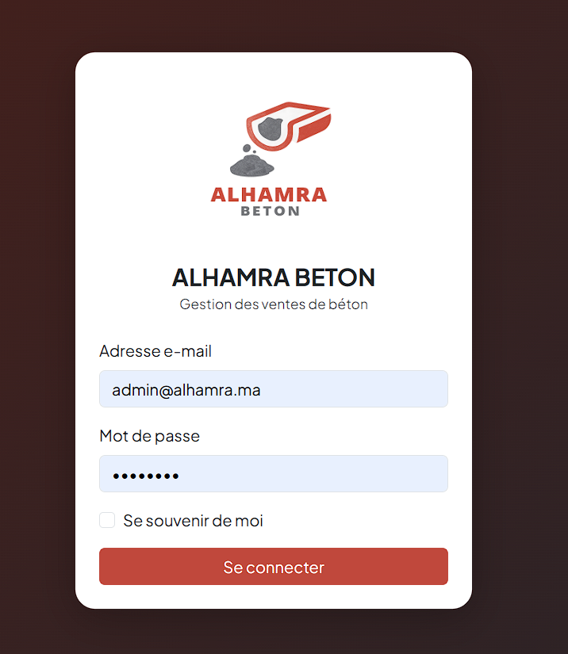
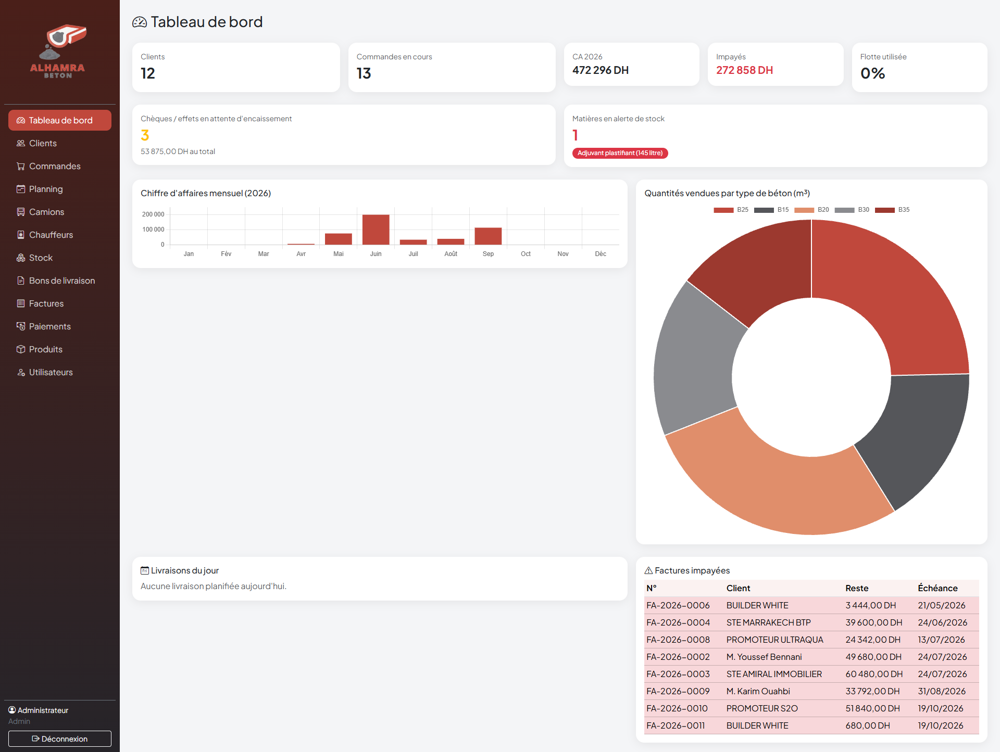
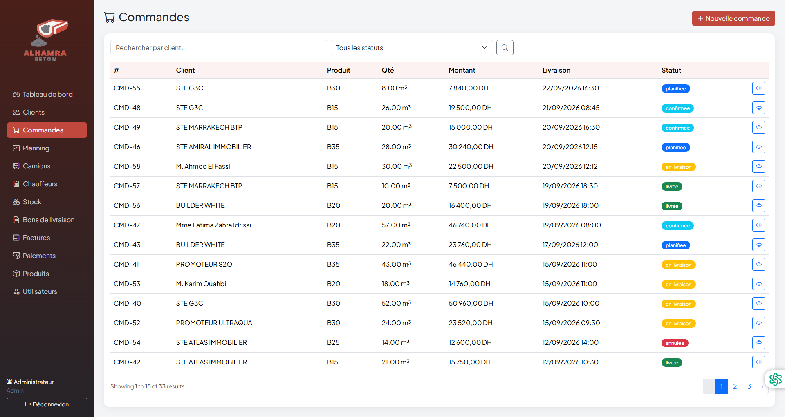
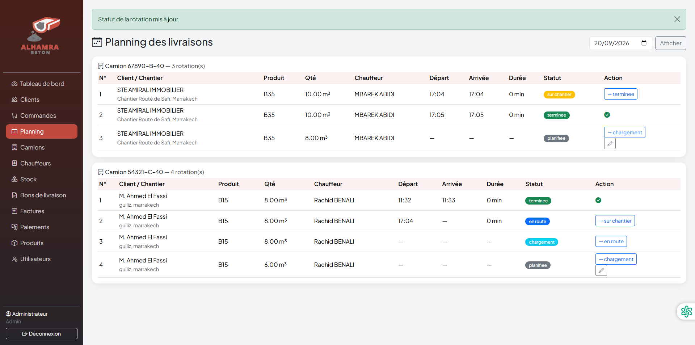
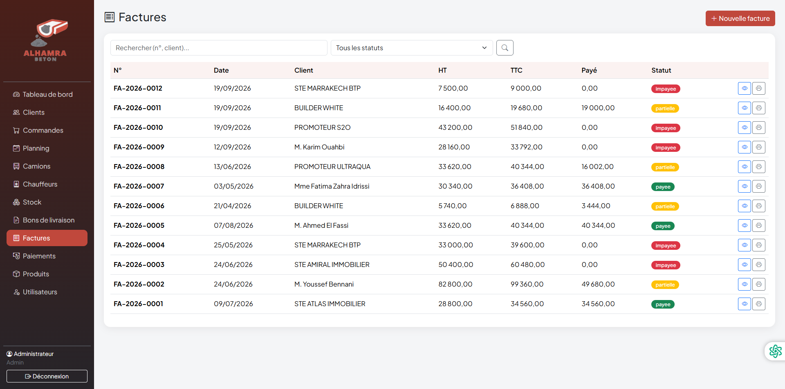
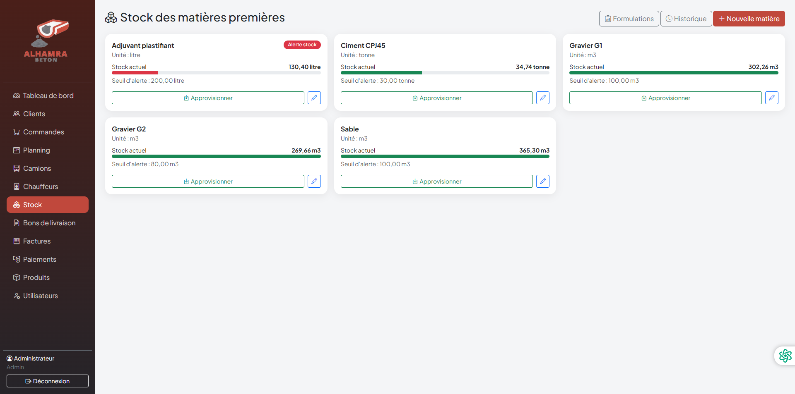

# Gestion des ventes de béton prêt à l'emploi — ALHAMRA BETON

Application web de gestion des ventes, de la logistique de livraison et de la facturation
d'une centrale à béton, développée avec **Laravel 10**, **MySQL**, **Bootstrap 5** et **Chart.js**.

> Projet de Fin d'Études — Licence SIR, FST Marrakech
> 
> Réalisé par : Hanane Khalis — Encadré par : M. Abdelmounaim Abdali

> ⚠️ Les données présentes dans ce dépôt (clients, commandes, factures...) sont **fictives**,
> générées par les seeders à des fins de démonstration.

---

## Aperçu

| | |
|---|---|
|  |  |
| **Connexion** | **Tableau de bord** (CA mensuel, ventes par type de béton, flotte) |
|  |  |
| **Commandes** et cycle de vie | **Planning des livraisons** et alerte des 90 min |
|  |  |
| **Facture** (HT / TVA / TTC) | **Stock matières premières** |

---

## 1. Prérequis

| Outil | Version minimale |
|---|---|
| PHP | 8.1 ou supérieur |
| Composer | 2.x |
| MySQL / MariaDB | via XAMPP |
| Navigateur moderne | Chrome / Edge / Firefox |

> Vérifier que les extensions PHP suivantes sont activées dans `php.ini` :
> `pdo_mysql`, `mbstring`, `openssl`, `fileinfo`, `ctype`, `tokenizer` (activées par défaut dans XAMPP).

## 2. Installation

```bash
# 1. Cloner le dépôt
git clone https://github.com/hanane-kh09/gestion-beton.git
cd gestion-beton

# 2. Installer les dépendances
composer install

# 3. Créer le fichier d'environnement
copy .env.example .env      # Windows
# cp .env.example .env      # Linux / macOS

# 4. Générer la clé de l'application
php artisan key:generate
```

> Les avertissements du type « Module "mysqli" is already loaded » ou « Unable to load
> dynamic library pdo_firebird / pdo_oci » sont sans gravité : ils proviennent du fichier
> `php.ini` de XAMPP et n'empêchent pas le fonctionnement. Pour les faire disparaître,
> commenter les lignes `extension=pdo_firebird` et `extension=pdo_oci` (avec un `;`)
> et supprimer la ligne `extension=mysqli` en double dans `C:\xampp\php81\php.ini`.

## 3. Base de données

1. Démarrer **Apache** et **MySQL** dans XAMPP.
2. Ouvrir phpMyAdmin (http://localhost/phpmyadmin) et créer une base vide nommée **`gestion_beton`**
   (interclassement : `utf8mb4_unicode_ci`).
3. Lancer les migrations et le jeu de données initial :

```bash
php artisan migrate --seed
```

## 4. Lancement

```bash
php artisan serve
```

Puis ouvrir : **http://localhost:8000**

### Comptes de démonstration

| Rôle | E-mail | Mot de passe |
|---|---|---|
| Administrateur | admin@alhamra.ma | password |
| Commercial | commercial@alhamra.ma | password |
| Logistique | logistique@alhamra.ma | password |
| Caissier | caissier@alhamra.ma | password |

## 5. Fonctionnalités

- **Clients** : CRUD, recherche, fiche client avec historique et solde.
- **Catalogue produits** : types de béton (B15 → B35) et services, prix au m³.
- **Commandes** : calcul automatique du montant, cycle de vie
  (en attente → confirmée → planifiée → en livraison → livrée).
- **Logistique** : flotte de camions toupies, chauffeurs, planification automatique des rotations
  (quantité ÷ capacité du camion), planning journalier par camion, suivi des états en temps réel,
  **alerte visuelle si le délai critique de 90 minutes est dépassé**.
- **Bons de livraison** : générés automatiquement à la fin de chaque rotation,
  numérotation `BL-AAAA-NNNN`, impression au format A4.
- **Factures** : regroupement des BL non facturés d'un client, calcul HT / TVA 20% / TTC,
  numérotation `FA-AAAA-NNNN`, impression au format A4.
- **Paiements** : espèces, chèque, virement, effet ; mise à jour automatique du statut de la facture
  (impayée / partielle / payée) ; suivi des soldes clients.
- **Tableau de bord** : CA mensuel, ventes par type de béton, taux d'utilisation de la flotte,
  livraisons du jour, factures impayées.
- **Administration** : gestion des utilisateurs avec 4 rôles
  (admin, commercial, logistique, caissier) et contrôle d'accès par middleware.

## 6. Impression des documents (BL / Factures)

Les bons de livraison et les factures disposent d'une vue d'impression au format A4 :
bouton **« Imprimer / PDF »** → la boîte de dialogue du navigateur permet d'imprimer
ou d'**enregistrer en PDF** (aucune dépendance externe requise).

## 7. Basculer vers SQLite (mode desktop autonome)

Pour un fonctionnement sans serveur MySQL (packaging desktop) :

1. Créer un fichier vide `database/database.sqlite`.
2. Dans `.env`, remplacer la configuration DB par :

```
DB_CONNECTION=sqlite
DB_DATABASE=C:/chemin/vers/gestion-beton/database/database.sqlite
```

3. Relancer `php artisan migrate --seed`.

Les migrations sont écrites de manière portable et fonctionnent à l'identique sous MySQL et SQLite.

## 8. Packaging en application desktop (PHP Desktop)

1. Télécharger **PHP Desktop Chrome** : https://github.com/cztomczak/phpdesktop
2. Extraire l'archive, puis copier tout le projet dans le dossier `www/`.
3. Dans `settings.json`, définir :
   - `"web_server" > "www_directory": "www/public"`
   - `"web_server" > "index_files": ["index.php"]`
4. Utiliser SQLite (voir section 7) pour éviter toute dépendance à MySQL.
5. (Optionnel) Créer un installateur Windows avec **Inno Setup**.

> Remarque : les feuilles de style (Bootstrap, icônes, Chart.js) sont chargées via CDN.
> Pour un usage 100 % hors ligne, télécharger ces fichiers dans `public/assets/`
> et mettre à jour les liens dans `resources/views/layout.blade.php`.

## 9. Structure du projet

```
gestion-beton/
├── app/
│   ├── Http/Controllers/     (12 contrôleurs métier)
│   ├── Http/Middleware/      (contrôle d'accès par rôle)
│   └── Models/               (10 modèles Eloquent)
├── database/
│   ├── migrations/           (10 tables)
│   └── seeders/              (données initiales)
├── docs/screenshots/         (captures d'écran du README)
├── resources/views/          (40 vues Blade + Bootstrap 5)
└── routes/web.php
```

## 10. Limites connues et prochaines étapes

> À ADAPTER selon la réalité du projet, par exemple :
> - Pas de tests automatisés (PHPUnit) pour l'instant
> - Assets chargés via CDN (pas de mode 100 % hors ligne par défaut)
> - Génération PDF via l'impression navigateur (pas de librairie dédiée)
> - Pas de déploiement en ligne : démo en local uniquement
